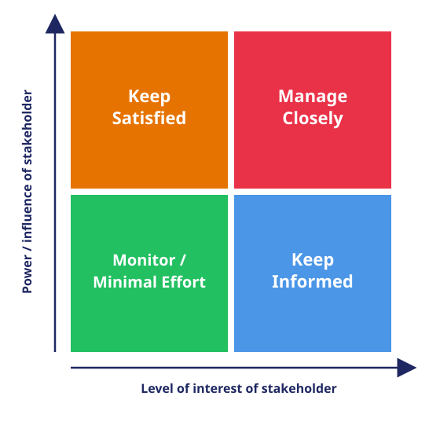

# Stakeholder Mapping

## The 4-Step Mapping Process

1. **Identify:** List all internal and external parties involved, impacted, or capable of influencing the work (such as team members, customers, regulators, and suppliers).
2. **Analyze:** Evaluate each stakeholder's specific level of power/influence and interest/concern regarding the project.
3. **Map:** Plot them onto a 2x2 Power/Interest Grid to visualize where they sit.
4. **Engage:** Build tailored communication and management plans for each quadrant.

## The 2x2 Power/Interest Grid Quadrants

- **Manage Closely** (High Power, High Interest): These are your key players. Involve them heavily and collaborate directly through regular meetings.
- **Keep Satisfied** (High Power, Low Interest): Keep these stakeholders happy with high-level status updates, avoiding information overload.
- **Keep Informed** (Low Power, High Interest): Keep these groups updated via newsletters, FAQs, or reports because they care deeply about the outcome.
- **Monitor / Minimal Effort** (Low Power, Low Interest): Track these stakeholders with light, periodic monitoring without overburdening them with communication.

## Step 1 & 2 — Identify and Analyze

| Stakeholder | Internal / External | Power (Low/High) | Interest (Low/High) | Quadrant |
| ----------- | ------------------- | ---------------- | ------------------- | -------- |
|             |                     |                  |                     |          |
|             |                     |                  |                     |          |
|             |                     |                  |                     |          |

## Step 3 — Map

Plot each stakeholder from the table above onto the grid below (write names/initials into the quadrant they fall into, or print this page and stick notes onto it).

## Step 4 — Engage

| Quadrant                 | Stakeholders | Communication / Management Plan |
| ------------------------ | ------------ | ------------------------------- |
| Manage Closely           |              |                                 |
| Keep Satisfied           |              |                                 |
| Keep Informed            |              |                                 |
| Monitor / Minimal Effort |              |                                 |
